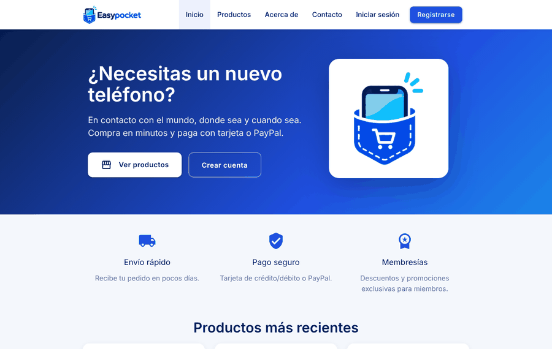
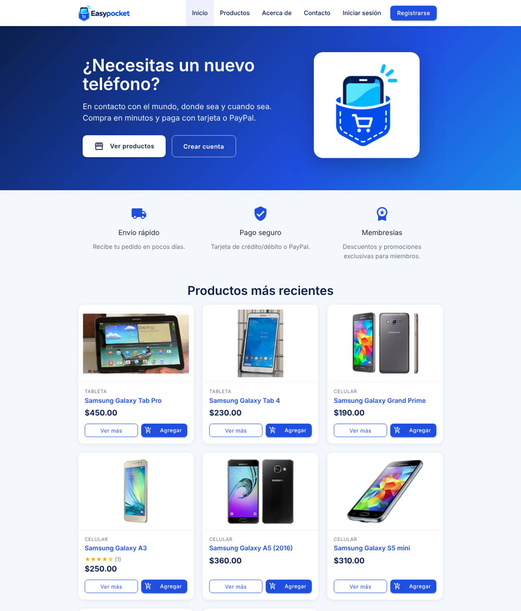
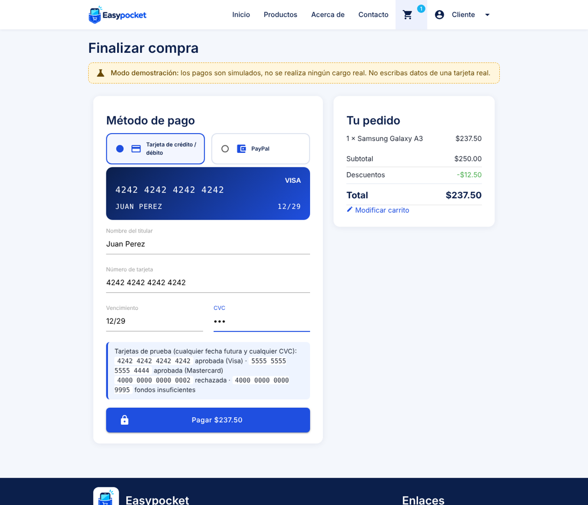
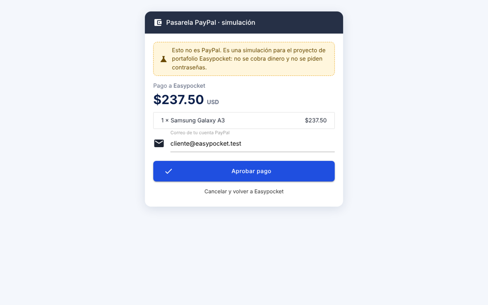
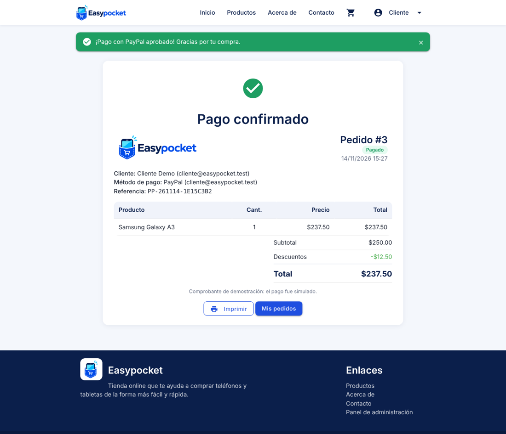

<p align="center">
  
</p>

<p align="center">
  An online phone & tablet shop with simulated card and PayPal payments and a role-based admin panel.<br>
  <em>My 2016 high-school final project, rebuilt in 2026 with PHP 8 and MySQL.</em>
</p>

<p align="center">
  
  
  
  
  
</p>

---

> **This is a showcase.** It contains screenshots, a demo and selected code samples.
> The full source code is in a private repository. **If you're a recruiter or employer and would like to review it, contact me and I'll give you access.**

<p align="center">
  
</p>

## What it does

### Shop
- Catalogue with search, category filter, star ratings and product pages
- Customer accounts: sign-up with a membership choice, 18+ check and an anti-bot question; profile, order history and a printable receipt
- **Memberships & promotions**: each customer automatically sees their own price. An active promotion for their membership wins; otherwise their membership's % discount applies
- **Checkout with two simulated payment methods**
  - **Card**: live card preview, brand detection, Luhn check, expiry and CVC validation, and test cards that are approved or declined
  - **PayPal**: a redirect to a clearly labelled simulated approval page and back, the same round trip a real integration makes
- Reviews, contact form, and password recovery with a one-time link that expires after 30 minutes

### Admin panel
- **Dashboard** built from real data (Chart.js): sales by month, best sellers, payment methods, low-stock alerts
- Products with image upload, product types, inventory restocking with history
- **Orders**: filtering, details, and cancel with a simulated refund that puts the units back into stock
- Promotions, memberships, customers (block/unblock), review moderation, contact messages
- **Staff roles with per-module permissions**: each user only sees and opens what their role allows
- **PDF reports** (FPDF): stock value, sales, staff

| Shop | Checkout | Simulated PayPal |
|---|---|---|
|  |  |  |

| Receipt | Admin dashboard |
|---|---|
|  |  |

## Code samples

A few parts of the system I think show my work best:

| File | What it shows |
|---|---|
| [`create-order.php`](code-samples/create-order.php) | Turns the cart into an order inside **one database transaction**. It locks the product rows (`SELECT … FOR UPDATE`), re-checks stock and prices on the server, and rolls everything back if anything fails. |
| [`payment-simulator.php`](code-samples/payment-simulator.php) | Card validation: Luhn algorithm, brand detection, expiry and CVC rules, test cards. Only the brand and last 4 digits are ever stored. |
| [`paypal-approval.php`](code-samples/paypal-approval.php) | The PayPal round trip: an expiring token, CSRF check, and a fingerprint of the cart so the payment is cancelled if the cart changes in another tab. |
| [`pricing.php`](code-samples/pricing.php) | Pricing rules: membership validity, promotions per membership, % discounts. |
| [`login-lockout.php`](code-samples/login-lockout.php) | Login with lockout after 3 failed attempts, timing-safe checks, automatic password re-hashing and permission guards for the admin panel. |
| [`security-helpers.php`](code-samples/security-helpers.php) | CSRF tokens and safe image uploads (real type check, random file names, size limit). |
| [`orders-schema.sql`](code-samples/orders-schema.sql) | The orders and payment tables. |

## How payments flow

```
Cart ──► Checkout ──┬── Card ───► validate & simulate bank answer ──► create_order() ──► Receipt
                    │
                    └── PayPal ─► simulated approval page ─► approve ─► create_order() ──► Receipt
                                                           └ cancel ──► back to checkout
```

Prices and totals are always recalculated on the server; nothing the browser sends is trusted.

## Security

- PDO prepared statements for every query
- `password_hash()` / `password_verify()`, with old hashes upgraded automatically on login
- CSRF tokens on every form, and output escaped everywhere
- Login lockout, session timeout, session ID regeneration
- Uploads checked by their real image type and stored where PHP can't run
- Configuration, includes and SQL files blocked from the browser, and secrets kept out of the repository

## From 2016 to 2026

The original version was my high-school final project. When I came back to it, it couldn't run: the database dump didn't import, the code and the schema didn't match, the admin pages had no login check, and the "payment" was a static mock-up. I rebuilt it to:

- fix the SQL injection, XSS and missing authentication problems,
- redesign the database (real date types, foreign keys, orders that store totals and payment details),
- build a working cart and the card/PayPal payment simulation,
- replace hard-coded charts with a real-data dashboard,
- remove unused libraries and give it a new brand identity.

## Tech stack

PHP 8 · MySQL / MariaDB · PDO · Materialize 1.0 · Chart.js 4 · FPDF · vanilla JavaScript

## Author

**Fernando**, Computer Science student at the University of Sunderland.

---

<sub>© 2016–2026 Fernando. All rights reserved. The code samples are shown for portfolio purposes only and may not be copied or reused (see [LICENSE](LICENSE)). Product photos are manufacturer/press images used for demonstration only. Samsung, Galaxy and PayPal are trademarks of their respective owners; this project is not affiliated with them.</sub>
